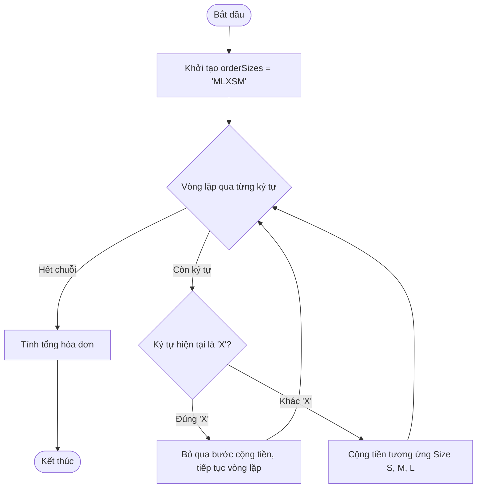

# Báo cáo bài tập: Khắc phục Lỗi Bỏ sót Phần tử khi Sử dụng continue trong Vòng lặp

> 👤 **Học viên:** Hoàng Công Dũng | **Mã SV:** PTIT-HCM-009
> 🏫 **Môn học:** it103b-rl-HoangCongDung

---

## 📊 Sơ đồ thiết kế hệ thống (Flowchart)

> 💡 *Sơ đồ dưới đây được render tự động trực tiếp trên GitHub bằng Mermaid. Bạn cũng có thể tải file **`bt2.drawio`** trong repository này để mở và chỉnh sửa trực tiếp trên [Draw.io (diagrams.net)](https://app.diagrams.net).* 

---

## Nhiệm vụ 1: Phân tích lỗi & Lập bảng Test Cases

Sau khi đọc kỹ mã nguồn hiện tại, tôi nhận thấy nguyên nhân cốt lõi khiến hệ thống thất thoát doanh thu nằm ở việc sử dụng câu lệnh break khi gặp ký tự 'X' (mã hủy món). Cụ thể, chuỗi orderSizes là 'MLXSM', khi vòng lặp chạy đến chỉ số index ứng với ký tự 'X', câu lệnh break ngay lập tức làm đứt gãy toàn bộ vòng lặp, khiến chương trình dừng lại và bỏ qua hoàn toàn hai ký tự 'S' và 'M' ở phía sau.

Để khắc phục sự cố nghiệp vụ này mà vẫn đảm bảo tính đúng đắn, ta cần thay thế break bằng continue. Cấu trúc continue sẽ giúp hệ thống bỏ qua bước xử lý tiền của riêng ký tự 'X' nhưng vẫn tiếp tục duy trì vòng lặp để quét hết các ly đồ uống hợp lệ còn lại trong hóa đơn.

- Dòng lệnh sai logic hiện tại: if (currentDrinkSize === 'X') { break; }
- Nguyên nhân kỹ thuật: break gây thoát khỏi vòng lặp ngay lập tức khi gặp lỗi, vi phạm yêu cầu duyệt toàn bộ chuỗi.
- Giải pháp kỹ thuật: Đổi break thành continue để bỏ qua phần tử 'X' và chuyển tiếp sang lần lặp tiếp theo.

| Trường hợp kiểm thử | Dữ liệu đầu vào | Kết quả sai thực tế | Kết quả đúng mong đợi |
| --- | --- | --- | --- |
| TC01: Hóa đơn có ký tự hủy ở giữa | orderSizes = 'MLXSM', toppingCount = 2, isGoldMember = true | Tổng tiền chỉ tính ly 'M' đầu tiên, bỏ quên ly 'X', 'S', 'M' phía sau do gặp break | Tính đúng tiền cho ly 'M', bỏ qua 'X', và cộng tiếp cho ly 'S', 'M' phía sau |
| TC02: Hóa đơn chuẩn không có mã hủy | orderSizes = 'SMS', toppingCount = 1, isGoldMember = false | Tính đúng tiền cho 'S', 'M', 'S' | Tính đúng tiền cho 'S', 'M', 'S' (Logic cũ và mới khớp nhau nếu không có 'X') |

## Nhiệm vụ 2: Sửa lỗi mã nguồn

Dưới đây là mã nguồn đã được tối ưu toàn diện trong tệp solution_ex3.js, áp dụng chuẩn Clean Code và sử dụng continue để xử lý chính xác 100% nghiệp vụ quầy Highlands.

- Đã thay thế break thành continue trong điều kiện kiểm tra ký tự 'X'.
- Giữ nguyên cấu trúc tính tiền mạch lạc, dễ đọc, tuân thủ các quy định đặt tên biến.
- Đã bổ sung bảng đối soát kết quả chi tiết vào cuối file mã nguồn theo đúng yêu cầu.

---

## 📁 Danh sách tệp tin nộp bài trong Repository
- 📝 `bt2.docx`: Báo cáo tài liệu phân tích nghiệp vụ hoàn chỉnh.
- 🎨 `bt2.drawio`: File thiết kế sơ đồ chuẩn theo quy định đề bài (mở trực tiếp bằng [Draw.io](https://app.diagrams.net) hoặc Lucidchart).
- 💻 `solution_ex3.js`: Mã nguồn chương trình.
